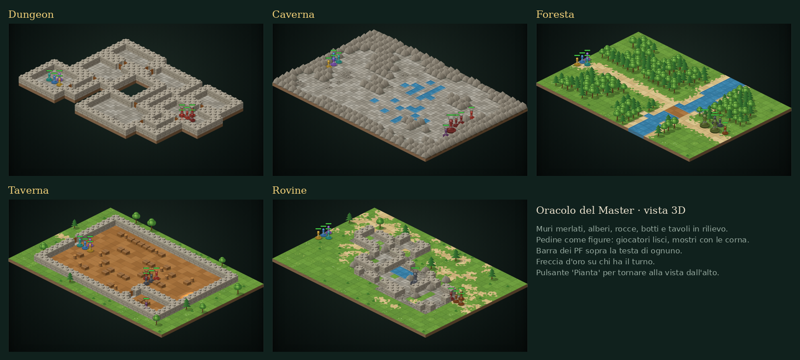
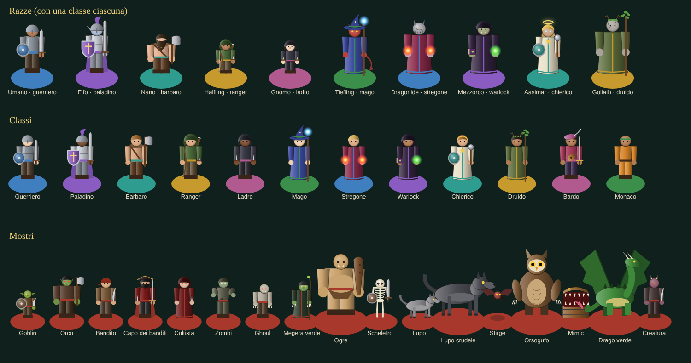

# Oracolo del Master



Tavolo virtuale per chi fa da Master a Dungeons & Dragons 5e. Genera la scena, mette giocatori e mostri sulla mappa e gestisce il combattimento: tutto in una pagina, senza installare nulla.

## Cosa fa

**Vista 3D in stile strategico**: la mappa è un plastico isometrico con muri merlati, alberi, rocce, botti e tavoli in rilievo. Le pedine sono figure in piedi con la barra dei PF sopra la testa; i mostri hanno le corna. Chi finisce dietro un muro resta visibile in trasparenza. Il pulsante *Pianta* passa alla classica vista dall'alto.

**Personaggi e mostri riconoscibili**
- 10 razze (umano, elfo, nano, halfling, gnomo, tiefling, dragonide, mezzorco, aasimar, goliath) con tratti propri: orecchie a punta, barbe, corna e coda, muso squamoso, zanne, aureola
- 12 classi con equipaggiamento disegnato: elmo e scudo, cappello da mago e bastone, cappuccio e pugnali, arco e faretra, liuto, simbolo sacro…
- Ogni mostro del bestiario ha la sua figura: goblin, scheletro, lupo, stirge, orsogufo, mimic, giovane drago verde e gli altri
- Il colore scelto per la pedina tinge basetta, scudo, mantello e dettagli; "Cambia aspetto" varia pelle e capelli



**Scene e ambientazioni**
- 5 ambientazioni generate a caso: Dungeon, Caverna, Foresta, Taverna, Rovine
- 4 difficoltà (Facile, Media, Difficile, Mortale) che decidono quanti mostri e se c'è un capo
- Ogni scena ha un nome, un'atmosfera, un PNG con un segreto e uno spunto d'avventura
- Pennello per dipingere il terreno a mano (muri, acqua, alberi, porte, fuoco, mobili…) o partire da una mappa vuota

**Pedine**
- Giocatori e mostri sulla griglia (1 casella = 5 piedi), trascinabili con mouse o dito
- Mentre trascini vedi la distanza in piedi; diventa rossa se superi la velocità della pedina
- Creature Grandi (2×2) ed Enormi (3×3)
- Scheda modificabile: nome, PF, CA, iniziativa, velocità, colore, condizioni
- Bestiario con 16 mostri del SRD 5.1 (goblin, ogre, megera verde, giovane drago verde…)

**Combattimento**
- Tiro d'iniziativa per tutti con un tocco, ordine dei turni e contatore dei round
- Danno e cura per ogni creatura; i mostri a 0 PF vengono saltati, i giocatori restano a terra
- Barra del turno sopra la mappa e registro di tutto ciò che succede

**Dadi**
- d4, d6, d8, d10, d12, d20, d100 con quantità e modificatore
- Vantaggio e svantaggio per il d20, segnala 20 e 1 naturali
- Formule libere tipo `2d6+3`

**Schermo intero**
- Il pulsante *Schermo intero* lascia solo la mappa, con il pannello che si apre di lato
- Tutti gli strumenti (Dipingi, Gomma, Stanza, Aggiungi) hanno i loro comandi in un vassoio sopra la mappa: si costruisce la scena senza uscire, comodo su tablet
- Su iPhone: in Safari *Condividi → Aggiungi alla schermata Home* e il gioco si apre come un'app, senza barre del browser

Il tavolo si salva da solo nel browser: chiudi la pagina e riprendi da dove eri.

## Comandi

| Azione | Come |
|---|---|
| Annullare / ripetere | ↶ e ↷ nella barra o in cima al pannello, oppure Ctrl+Z / Ctrl+Maiusc+Z |
| Muovere una pedina | trascinala |
| Spostare la mappa | trascina uno spazio vuoto |
| Zoom | rotella, due dita, o i pulsanti − / + |
| Ruotare la mappa 3D | ⟲ ⟳ nella barra, tasti Q / E, o ruota due dita sul tablet; la bussola mostra il nord |
| Dipingere il terreno | scegli un terreno in *Scena → Pennello* e trascina sulla mappa |
| Disegnare una stanza | *Stanza*, scegli il pavimento e trascina da un angolo all'altro: muri, pavimento e porta |
| Aggiungere eroi e mostri | *Aggiungi*, scegli dalla galleria (o razza e classe per un eroe) e tocca la mappa |
| Cancellare elementi | *Gomma* e trascina: muri, alberi, mobili, acqua spariscono e torna il terreno intorno |
| Pennello più grande | con *Dipingi* o *Gomma* attivi, scegli 1, 2 o 3 caselle |
| Turno successivo | pulsante *Prossimo turno* o tasto `N` |
| Togliere una pedina | × accanto al nome in *Pedine*, *Togli* nella scheda rapida, o `Canc`; poi *Annulla* se ti sei sbagliato |
| Togliere più mostri | *Pedine → Togli i mostri sconfitti* o *Togli tutti i mostri* |

## Avvio

Apri `index.html` nel browser, oppure servilo in locale:

```bash
npx serve .          # oppure: python3 -m http.server
```

Per un unico file autonomo (CSS e JS incorporati):

```bash
node scripts/build.mjs   # → dist/oracolo.html
```

## Pubblicare su GitHub Pages

```bash
git remote add origin https://github.com/<utente>/oracolo-del-master.git
git push -u origin main
```

Poi su GitHub: *Settings → Pages → Deploy from branch → main / root*.

Prima di ogni pubblicazione lancia `node scripts/versione.mjs`: aggiorna il numero di versione dei file, così i telefoni scaricano subito il codice nuovo invece di usare quello in cache.

## Struttura

```
index.html          pagina e pannelli
src/mapgen.js       terreni e generatori di mappe
src/board.js        mappa su canvas: pan/zoom, trascinamento, pennello, vista dall'alto
src/iso.js          vista 3D isometrica: terreno, oggetti in rilievo
src/figure.js       figure di razze, classi e mostri, ritratti
src/app.js          stato del tavolo, pedine, combattimento, dadi, salvataggio
src/bestiario.js    mostri, abitanti per ambientazione, difficoltà, dadi
src/data.js         tabelle per nomi, atmosfere, PNG, spunti
src/generator.js    estrazione casuale con semi riproducibili
src/style.css       stile "tavolo da gioco"
scripts/build.mjs   versione a file singolo
```

## Aggiungere contenuti

- **Un mostro**: aggiungi una voce a `BESTIARIO` in `src/bestiario.js`, il suo aspetto in `MOSTRI` dentro `src/figure.js` (parametri di un umanoide o un disegno dedicato), e il suo nome in `ABITANTI` se vuoi che compaia nelle scene generate.
- **Una razza o una classe**: aggiungi una voce a `RAZZE` o `CLASSI` in `src/figure.js`.
- **Un terreno**: aggiungi un elemento a `TERRENI` in `src/mapgen.js` e, se vuoi un disegno speciale, un `case` in `disegnaCasella` (`src/board.js`, vista dall'alto) e in `disegnaOggetto` (`src/iso.js`, vista 3D).
- **Un'ambientazione**: scrivi una funzione generatrice in `src/mapgen.js`, registrala in `GENERATORI` e `AMBIENTI`, e dai i suoi abitanti in `ABITANTI`.

## Idee per il futuro

- Nebbia di guerra: il Master scopre la mappa man mano
- Aree degli incantesimi (cono, sfera, linea) da appoggiare sulla mappa
- Vista per i giocatori su un secondo schermo
- Import/export del tavolo in JSON
- Immagini personalizzate per le pedine

## Licenza

Codice MIT. Le statistiche dei mostri vengono dal System Reference Document 5.1 (CC-BY-4.0, Wizards of the Coast).
